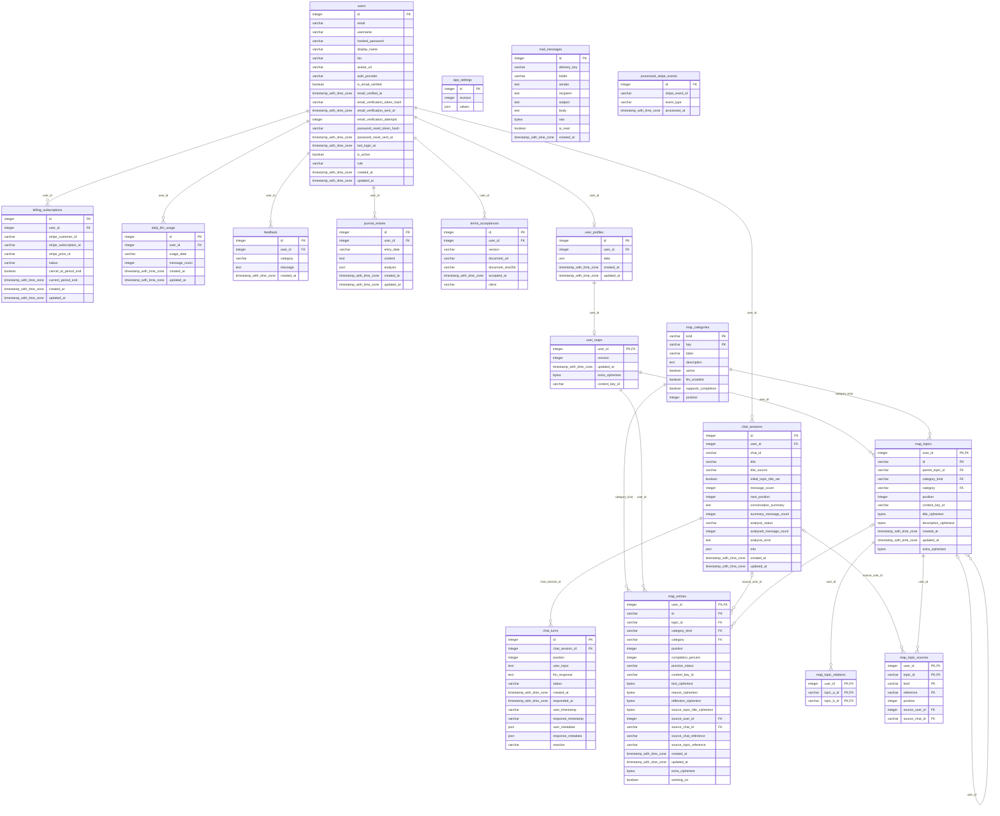

# FeelY database schema

Generated from SQLAlchemy metadata by `python -m scripts.database_schema`.
Run this inside the backend image with a repository bind mount when host Python is unavailable.
The versioned schema is managed by Alembic; generated SQL is a reference, not an upgrade script.

18 application tables, plus Alembic's `alembic_version` table.

## app_settings

| Column | PostgreSQL type | Nullable | Key |
| --- | --- | --- | --- |
| `id` | `INTEGER` | no | PK |
| `revision` | `INTEGER` | no |  |
| `values` | `JSON` | no |  |

- Check: `revision >= 1`.
- Check: `id = 1`.

## mail_messages

| Column | PostgreSQL type | Nullable | Key |
| --- | --- | --- | --- |
| `id` | `INTEGER` | no | PK |
| `delivery_key` | `VARCHAR(100)` | no |  |
| `folder` | `VARCHAR(20)` | no |  |
| `sender` | `TEXT` | no |  |
| `recipient` | `TEXT` | no |  |
| `subject` | `TEXT` | no |  |
| `body` | `TEXT` | no |  |
| `raw` | `BYTEA` | no |  |
| `is_read` | `BOOLEAN` | no |  |
| `created_at` | `TIMESTAMP WITH TIME ZONE` | no |  |

- Unique: `delivery_key`.
- Index `ix_mail_messages_folder`: `folder`.

## map_categories

| Column | PostgreSQL type | Nullable | Key |
| --- | --- | --- | --- |
| `kind` | `VARCHAR(16)` | no | PK |
| `key` | `VARCHAR(64)` | no | PK |
| `label` | `VARCHAR(120)` | no |  |
| `description` | `TEXT` | no |  |
| `active` | `BOOLEAN` | no |  |
| `llm_enabled` | `BOOLEAN` | no |  |
| `supports_completion` | `BOOLEAN` | no |  |
| `position` | `INTEGER` | no |  |

- Check: `position >= 0`.
- Check: `kind IN ('topic','entry')`.
- Check: `length(key) > 0 AND length(trim(label)) > 0`.

## processed_stripe_events

| Column | PostgreSQL type | Nullable | Key |
| --- | --- | --- | --- |
| `id` | `INTEGER` | no | PK |
| `stripe_event_id` | `VARCHAR(255)` | no |  |
| `event_type` | `VARCHAR(120)` | no |  |
| `processed_at` | `TIMESTAMP WITH TIME ZONE` | no |  |

- Index `ix_processed_stripe_events_id`: `id`.
- Index `ix_processed_stripe_events_stripe_event_id`: `stripe_event_id`.

## users

| Column | PostgreSQL type | Nullable | Key |
| --- | --- | --- | --- |
| `id` | `INTEGER` | no | PK |
| `email` | `VARCHAR(320)` | no |  |
| `username` | `VARCHAR(80)` | no |  |
| `hashed_password` | `VARCHAR(255)` | no |  |
| `display_name` | `VARCHAR(120)` | yes |  |
| `bio` | `VARCHAR(500)` | yes |  |
| `avatar_url` | `VARCHAR(500)` | yes |  |
| `auth_provider` | `VARCHAR(40)` | no |  |
| `is_email_verified` | `BOOLEAN` | no |  |
| `email_verified_at` | `TIMESTAMP WITH TIME ZONE` | yes |  |
| `email_verification_token_hash` | `VARCHAR(128)` | yes |  |
| `email_verification_sent_at` | `TIMESTAMP WITH TIME ZONE` | yes |  |
| `email_verification_attempts` | `INTEGER` | no |  |
| `password_reset_token_hash` | `VARCHAR(128)` | yes |  |
| `password_reset_sent_at` | `TIMESTAMP WITH TIME ZONE` | yes |  |
| `last_login_at` | `TIMESTAMP WITH TIME ZONE` | yes |  |
| `is_active` | `BOOLEAN` | no |  |
| `role` | `VARCHAR(16)` | no |  |
| `created_at` | `TIMESTAMP WITH TIME ZONE` | no |  |
| `updated_at` | `TIMESTAMP WITH TIME ZONE` | no |  |

- Unique: `email_verification_token_hash`.
- Unique: `password_reset_token_hash`.
- Index `ix_users_email`: `email`.
- Index `ix_users_id`: `id`.
- Index `ix_users_username`: `username`.

## billing_subscriptions

| Column | PostgreSQL type | Nullable | Key |
| --- | --- | --- | --- |
| `id` | `INTEGER` | no | PK |
| `user_id` | `INTEGER` | no | users.id |
| `stripe_customer_id` | `VARCHAR(255)` | yes |  |
| `stripe_subscription_id` | `VARCHAR(255)` | yes |  |
| `stripe_price_id` | `VARCHAR(255)` | yes |  |
| `status` | `VARCHAR(40)` | no |  |
| `cancel_at_period_end` | `BOOLEAN` | no |  |
| `current_period_end` | `TIMESTAMP WITH TIME ZONE` | yes |  |
| `created_at` | `TIMESTAMP WITH TIME ZONE` | no |  |
| `updated_at` | `TIMESTAMP WITH TIME ZONE` | no |  |

- Foreign key: `user_id` ? `users.id`; delete: CASCADE.
- Index `ix_billing_subscriptions_id`: `id`.
- Index `ix_billing_subscriptions_stripe_customer_id`: `stripe_customer_id`.
- Index `ix_billing_subscriptions_stripe_subscription_id`: `stripe_subscription_id`.
- Index `ix_billing_subscriptions_user_id`: `user_id`.

## chat_sessions

| Column | PostgreSQL type | Nullable | Key |
| --- | --- | --- | --- |
| `id` | `INTEGER` | no | PK |
| `user_id` | `INTEGER` | no | users.id |
| `chat_id` | `VARCHAR(120)` | no |  |
| `title` | `VARCHAR(120)` | no |  |
| `title_source` | `VARCHAR(32)` | no |  |
| `initial_topic_title_set` | `BOOLEAN` | no |  |
| `message_count` | `INTEGER` | no |  |
| `next_position` | `INTEGER` | no |  |
| `conversation_summary` | `TEXT` | yes |  |
| `summary_message_count` | `INTEGER` | no |  |
| `analysis_status` | `VARCHAR(32)` | no |  |
| `analysed_message_count` | `INTEGER` | yes |  |
| `analysis_error` | `TEXT` | yes |  |
| `info` | `JSON` | no |  |
| `created_at` | `TIMESTAMP WITH TIME ZONE` | no |  |
| `updated_at` | `TIMESTAMP WITH TIME ZONE` | no |  |

- Foreign key: `user_id` ? `users.id`; delete: NO ACTION.
- Unique: `user_id`, `chat_id`.
- Index `ix_chat_sessions_chat_id`: `chat_id`.
- Index `ix_chat_sessions_id`: `id`.
- Index `ix_chat_sessions_user_updated_id`: `user_id`, `updated_at`, `id`.

## daily_llm_usage

| Column | PostgreSQL type | Nullable | Key |
| --- | --- | --- | --- |
| `id` | `INTEGER` | no | PK |
| `user_id` | `INTEGER` | no | users.id |
| `usage_date` | `VARCHAR(10)` | no |  |
| `message_count` | `INTEGER` | no |  |
| `created_at` | `TIMESTAMP WITH TIME ZONE` | no |  |
| `updated_at` | `TIMESTAMP WITH TIME ZONE` | no |  |

- Foreign key: `user_id` ? `users.id`; delete: CASCADE.
- Unique: `user_id`, `usage_date`.
- Index `ix_daily_llm_usage_id`: `id`.
- Index `ix_daily_llm_usage_usage_date`: `usage_date`.
- Index `ix_daily_llm_usage_user_id`: `user_id`.

## feedback

| Column | PostgreSQL type | Nullable | Key |
| --- | --- | --- | --- |
| `id` | `INTEGER` | no | PK |
| `user_id` | `INTEGER` | no | users.id |
| `category` | `VARCHAR(24)` | no |  |
| `message` | `TEXT` | no |  |
| `created_at` | `TIMESTAMP WITH TIME ZONE` | no |  |

- Foreign key: `user_id` ? `users.id`; delete: CASCADE.
- Index `ix_feedback_user_id`: `user_id`.

## journal_entries

| Column | PostgreSQL type | Nullable | Key |
| --- | --- | --- | --- |
| `id` | `INTEGER` | no | PK |
| `user_id` | `INTEGER` | no | users.id |
| `entry_date` | `VARCHAR(10)` | no |  |
| `content` | `TEXT` | no |  |
| `analysis` | `JSON` | no |  |
| `created_at` | `TIMESTAMP WITH TIME ZONE` | no |  |
| `updated_at` | `TIMESTAMP WITH TIME ZONE` | no |  |

- Foreign key: `user_id` ? `users.id`; delete: CASCADE.
- Unique: `user_id`, `entry_date`.
- Index `ix_journal_entries_entry_date`: `entry_date`.
- Index `ix_journal_entries_id`: `id`.
- Index `ix_journal_entries_user_id`: `user_id`.

## terms_acceptances

| Column | PostgreSQL type | Nullable | Key |
| --- | --- | --- | --- |
| `id` | `INTEGER` | no | PK |
| `user_id` | `INTEGER` | no | users.id |
| `version` | `VARCHAR(80)` | no |  |
| `document_url` | `VARCHAR(2048)` | no |  |
| `document_sha256` | `VARCHAR(64)` | no |  |
| `accepted_at` | `TIMESTAMP WITH TIME ZONE` | no |  |
| `client` | `VARCHAR(16)` | no |  |

- Foreign key: `user_id` ? `users.id`; delete: CASCADE.
- Unique: `user_id`, `version`.
- Index `ix_terms_acceptances_user_id`: `user_id`.

## user_profiles

| Column | PostgreSQL type | Nullable | Key |
| --- | --- | --- | --- |
| `id` | `INTEGER` | no | PK |
| `user_id` | `INTEGER` | no | users.id |
| `data` | `JSON` | no |  |
| `created_at` | `TIMESTAMP WITH TIME ZONE` | no |  |
| `updated_at` | `TIMESTAMP WITH TIME ZONE` | no |  |

- Foreign key: `user_id` ? `users.id`; delete: NO ACTION.
- Unique: `user_id`.
- Index `ix_user_profiles_id`: `id`.

## chat_turns

| Column | PostgreSQL type | Nullable | Key |
| --- | --- | --- | --- |
| `id` | `INTEGER` | no | PK |
| `chat_session_id` | `INTEGER` | no | chat_sessions.id |
| `position` | `INTEGER` | no |  |
| `user_input` | `TEXT` | yes |  |
| `llm_response` | `TEXT` | yes |  |
| `status` | `VARCHAR(16)` | no |  |
| `created_at` | `TIMESTAMP WITH TIME ZONE` | no |  |
| `responded_at` | `TIMESTAMP WITH TIME ZONE` | yes |  |
| `user_timestamp` | `VARCHAR(64)` | yes |  |
| `response_timestamp` | `VARCHAR(64)` | yes |  |
| `user_metadata` | `JSON` | no |  |
| `response_metadata` | `JSON` | no |  |
| `reaction` | `VARCHAR(16)` | yes |  |

- Check: `position > 0`.
- Check: `status IN ('pending', 'completed', 'failed', 'legacy')`.
- Foreign key: `chat_session_id` ? `chat_sessions.id`; delete: CASCADE.
- Unique: `chat_session_id`, `position`.
- Index `ix_chat_turns_session_created`: `chat_session_id`, `created_at`.
- Index `ix_chat_turns_session_status_position`: `chat_session_id`, `status`, `position`.

## user_maps

| Column | PostgreSQL type | Nullable | Key |
| --- | --- | --- | --- |
| `user_id` | `INTEGER` | no | PK, user_profiles.user_id |
| `revision` | `INTEGER` | no |  |
| `updated_at` | `TIMESTAMP WITH TIME ZONE` | no |  |
| `extra_ciphertext` | `BYTEA` | yes |  |
| `content_key_id` | `VARCHAR(80)` | no |  |

- Check: `revision >= 1`.
- Check: `length(extra_ciphertext) >= 28`.
- Check: `length(content_key_id) > 0`.
- Foreign key: `user_id` ? `user_profiles.user_id`; delete: CASCADE.

## map_topics

| Column | PostgreSQL type | Nullable | Key |
| --- | --- | --- | --- |
| `user_id` | `INTEGER` | no | PK, map_topics.user_id, user_maps.user_id |
| `id` | `VARCHAR(64)` | no | PK |
| `parent_topic_id` | `VARCHAR(64)` | yes | map_topics.id |
| `category_kind` | `VARCHAR(16)` | no | map_categories.kind |
| `category` | `VARCHAR(64)` | no | map_categories.key |
| `position` | `INTEGER` | no |  |
| `content_key_id` | `VARCHAR(80)` | no |  |
| `title_ciphertext` | `BYTEA` | no |  |
| `description_ciphertext` | `BYTEA` | no |  |
| `created_at` | `TIMESTAMP WITH TIME ZONE` | yes |  |
| `updated_at` | `TIMESTAMP WITH TIME ZONE` | yes |  |
| `extra_ciphertext` | `BYTEA` | yes |  |

- Check: `parent_topic_id IS NULL OR parent_topic_id <> id`.
- Check: `category_kind = 'topic'`.
- Check: `length(description_ciphertext) >= 28`.
- Check: `length(extra_ciphertext) >= 28`.
- Check: `length(id) > 0`.
- Check: `length(content_key_id) > 0`.
- Check: `position >= 0`.
- Check: `length(title_ciphertext) >= 28`.
- Foreign key: `category_kind` ? `map_categories.kind`, `category` ? `map_categories.key`; delete: NO ACTION.
- Foreign key: `user_id` ? `map_topics.user_id`, `parent_topic_id` ? `map_topics.id`; delete: NO ACTION.
- Foreign key: `user_id` ? `user_maps.user_id`; delete: CASCADE.
- Index `ix_map_topics_category`: `user_id`, `category`.
- Index `ix_map_topics_parent`: `user_id`, `parent_topic_id`.

## map_entries

| Column | PostgreSQL type | Nullable | Key |
| --- | --- | --- | --- |
| `user_id` | `INTEGER` | no | PK, user_maps.user_id, map_topics.user_id |
| `id` | `VARCHAR(64)` | no | PK |
| `topic_id` | `VARCHAR(64)` | yes | map_topics.id |
| `category_kind` | `VARCHAR(16)` | no | map_categories.kind |
| `category` | `VARCHAR(64)` | no | map_categories.key |
| `position` | `INTEGER` | no |  |
| `completion_percent` | `INTEGER` | yes |  |
| `practice_status` | `VARCHAR(16)` | yes |  |
| `content_key_id` | `VARCHAR(80)` | no |  |
| `text_ciphertext` | `BYTEA` | no |  |
| `reason_ciphertext` | `BYTEA` | yes |  |
| `reflection_ciphertext` | `BYTEA` | yes |  |
| `source_topic_title_ciphertext` | `BYTEA` | yes |  |
| `source_user_id` | `INTEGER` | yes | chat_sessions.user_id |
| `source_chat_id` | `VARCHAR(120)` | yes | chat_sessions.chat_id |
| `source_chat_reference` | `VARCHAR(120)` | yes |  |
| `source_topic_reference` | `VARCHAR(64)` | yes |  |
| `created_at` | `TIMESTAMP WITH TIME ZONE` | yes |  |
| `updated_at` | `TIMESTAMP WITH TIME ZONE` | yes |  |
| `extra_ciphertext` | `BYTEA` | yes |  |
| `working_on` | `BOOLEAN` | no |  |

- Check: `completion_percent IS NULL OR completion_percent BETWEEN 0 AND 100`.
- Check: `length(extra_ciphertext) >= 28`.
- Check: `length(id) > 0`.
- Check: `length(content_key_id) > 0`.
- Check: `position >= 0`.
- Check: `length(reason_ciphertext) >= 28`.
- Check: `length(reflection_ciphertext) >= 28`.
- Check: `length(source_topic_title_ciphertext) >= 28`.
- Check: `length(text_ciphertext) >= 28`.
- Check: `category_kind = 'entry'`.
- Check: `source_chat_id IS NULL OR source_chat_id = source_chat_reference`.
- Check: `source_user_id IS NULL OR source_user_id = user_id`.
- Check: `(source_user_id IS NULL) = (source_chat_id IS NULL)`.
- Check: `practice_status IS NULL OR practice_status IN ('active','paused','completed')`.
- Foreign key: `category_kind` ? `map_categories.kind`, `category` ? `map_categories.key`; delete: NO ACTION.
- Foreign key: `source_user_id` ? `chat_sessions.user_id`, `source_chat_id` ? `chat_sessions.chat_id`; delete: SET NULL.
- Foreign key: `user_id` ? `map_topics.user_id`, `topic_id` ? `map_topics.id`; delete: NO ACTION.
- Foreign key: `user_id` ? `user_maps.user_id`; delete: CASCADE.
- Index `ix_map_entries_progress`: `user_id`, `category`, `completion_percent`.
- Index `ix_map_entries_source_chat`: `source_user_id`, `source_chat_id`.
- Index `ix_map_entries_topic`: `user_id`, `topic_id`, `position`.

## map_topic_relations

| Column | PostgreSQL type | Nullable | Key |
| --- | --- | --- | --- |
| `user_id` | `INTEGER` | no | PK, map_topics.user_id, map_topics.user_id |
| `topic_a_id` | `VARCHAR(64)` | no | PK, map_topics.id |
| `topic_b_id` | `VARCHAR(64)` | no | PK, map_topics.id |

- Check: `topic_a_id < topic_b_id`.
- Foreign key: `user_id` ? `map_topics.user_id`, `topic_a_id` ? `map_topics.id`; delete: CASCADE.
- Foreign key: `user_id` ? `map_topics.user_id`, `topic_b_id` ? `map_topics.id`; delete: CASCADE.
- Index `ix_map_relations_reverse`: `user_id`, `topic_b_id`.

## map_topic_sources

| Column | PostgreSQL type | Nullable | Key |
| --- | --- | --- | --- |
| `user_id` | `INTEGER` | no | PK, map_topics.user_id |
| `topic_id` | `VARCHAR(64)` | no | PK, map_topics.id |
| `kind` | `VARCHAR(16)` | no | PK |
| `reference` | `VARCHAR(120)` | no | PK |
| `position` | `INTEGER` | no |  |
| `source_user_id` | `INTEGER` | yes | chat_sessions.user_id |
| `source_chat_id` | `VARCHAR(120)` | yes | chat_sessions.chat_id |

- Check: `kind IN ('chat','journal')`.
- Check: `source_user_id IS NULL OR source_user_id = user_id`.
- Check: `(source_user_id IS NULL) = (source_chat_id IS NULL)`.
- Check: `source_chat_id IS NULL OR (kind = 'chat' AND source_chat_id = reference)`.
- Check: `position >= 0`.
- Foreign key: `source_user_id` ? `chat_sessions.user_id`, `source_chat_id` ? `chat_sessions.chat_id`; delete: SET NULL.
- Foreign key: `user_id` ? `map_topics.user_id`, `topic_id` ? `map_topics.id`; delete: CASCADE.
- Index `ix_map_sources_chat`: `source_user_id`, `source_chat_id`.

## Design review and encryption

See [the database review](DATABASE_REVIEW.md) for remaining JSON fields, sensitive plaintext outside the map, retention concerns and recommended follow-up work.
See [map storage](MAP_DATABASE_SCHEMA.md) for migration, categories, completion and key handling.
