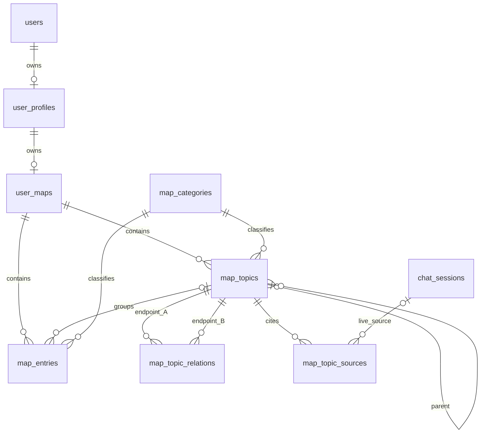

# Relational map storage

Map storage is implemented in revision `0003`. The full current schema, including
all other application tables, is in [DATABASE_SCHEMA.md](DATABASE_SCHEMA.md);
[database-schema.sql](database-schema.sql) is generated reference SQL. Use Alembic
for upgrades, not that reference file.

Revision `0004` adds `map_entries.working_on`, a non-null boolean defaulting to
`false`. Every entry can be marked **Working on** in the frontend entry editor;
the entry preview shows the marker when checked. This flag is independent of
category, completion percentage and practice status. Entry create/update APIs
accept `working_on`; omitting it on update preserves the current value.



## Tables and access

| Table | One row represents |
| --- | --- |
| `user_maps` | One user's map, its revision and modification time |
| `map_topics` | One topic with an optional same-owner parent |
| `map_entries` | One observation/practice/task; `topic_id=NULL` means unassigned |
| `map_topic_relations` | One undirected topic pair, stored once in canonical ID order |
| `map_topic_sources` | One topic/chat or historical journal reference, with an optional live chat foreign key |
| `map_categories` | One stable topic/entry category key and its editable settings |

A profile can have at most one map because `user_maps.user_id` is its primary key.
Map entities use `(user_id,id)` composite keys; topic and parent foreign keys
include the owner. Source links use a separate nullable owner/chat pair so a chat
can be deleted without deleting historical provenance or clearing the map owner.
All queries must still authenticate and bind the current user. Foreign keys are
integrity controls, not row-level authorization policies.

Topics, entries, sources, categories and relationships are queryable rows. The
existing API's JSON response is reconstructed at the storage boundary. The
`UserProfile.data` compatibility accessor composes ordinary profile memory with
that map view; the stored `user_profiles.data` column contains no map after
migration. Generic profile updates cannot replace the map.

Original IDs, order, timestamp spelling and optional/unknown legacy attributes
are preserved. Unknown attributes and shape/formatting metadata have their own
encrypted compatibility column per entity. Core fields are typed columns, not
hidden in that column. Historical journal references are separate source rows.
Peer relationships are unordered; API peer arrays may be returned in a canonical
order after migration.

The map response exposes `revision`. Map create/update/merge/practice bodies accept
optional `expected_revision`; delete endpoints accept it as a query parameter. The
map editor sends it automatically. Stale client revisions return HTTP 409. Older
clients may omit it; overlapping in-flight writes are still protected.

Every changed map uses a revision compare-and-swap within the same transaction as
its profile write and row reconciliation. Stale writes return HTTP 409. Readers
verify that the revision stayed stable across the row reads. Parent-cycle
validation happens in the service before persistence; the database rejects
self-parents and missing/foreign-owner parents, but unrestricted direct SQL can
still create a longer cycle. Do not bypass the service for hierarchy edits.

## Completion

`map_entries.completion_percent` is an optional integer from 0 to 100, enforced by
both request validation and a database check. NULL means tracking is not set.
The create/update entry APIs accept this field and the map editor displays it.
Moving between topics or unassigning an entry keeps its progress and ID.

Categories can opt into starting completion tracking at zero. Practices have
additional status/reflection fields. Completing a practice sets 100%; reducing
its percentage reactivates it. Reactivating/pausing a completed practice resets
its percentage to zero. A task can reach 100% without becoming a practice.
Models receive category definitions, but completion percentages are user input.

## Editable category catalog

Open `/admin.html` and use **Map categories**. Admin endpoints:

- `GET /api/v1/admin/map/categories`: full catalog.
- `PUT /api/v1/admin/map/categories/{kind}/{key}`: create or update (`kind=topic|entry`).
- `GET /api/v1/users/me/map/categories`: authenticated catalog for API clients.

A category has a stable key, label, description, enabled state, LLM-enabled state,
display order and completion-tracking preference. Rename a label freely; keep
keys stable. Disable unused keys rather than deleting historical categories.
Disabled categories remain visible on saved records and can retain their current
classification while other fields are edited; they are unavailable for new use.
`other` and internal `merged_topic` remain available for compatibility. The merge
provenance category cannot be enabled for LLM suggestions.

New map loads include catalog metadata. Forms and review dialogs use those
backend choices. Model system prompts and request payloads receive the enabled
catalog with descriptions; Ollama's structured schema and response validation
use the same keys. Editing categories needs no deployment or provider rewrite.
The deterministic development/mock provider remains a canned test implementation;
it does not learn new suggestion strategies from category descriptions.

## Encryption

Titles, descriptions, entry text, reasons, reflections, source-topic titles and
legacy compatibility attributes use AES-256-GCM. Values have independent random
12-byte nonces and authentication tags. Associated data binds the schema version,
owner, record ID and field name, so swapping ciphertext between users/fields/rows
fails integrity validation. There is no plaintext fallback.

The backend reads `CONTENT_ENCRYPTION_KEYS`, a JSON object of key IDs to base64
32-byte keys, and `CONTENT_ENCRYPTION_KEY_ID`, the active write key. Keys are
independent of JWT signing secrets and database passwords. Fresh local Docker
setup generates a random key. Production requires a configured key ring.
Private backend environment files contain keys; PostgreSQL rows contain only key
IDs. Keep env files private and back up key material separately from database
archives. Docker administrators and a compromised backend host may access both.
This is server-managed encryption, not end-to-end encryption.

IDs, owners, categories, completion/status, relationships, timestamps and approximate
text lengths remain visible to database readers. Authorized backend code decrypts
text for the website and analysis. Selected plaintext can still be sent to your
configured model provider. SQL cannot search/sort encrypted text; per-user title
matching and text operations currently decrypt map content in the backend.

Add a new key under a new ID for rotation; keep old keys readable. Switch the
active ID only after distributing the expanded ring. A changed map is re-encrypted
under the active key as part of normal row reconciliation. There is no automatic
whole-database rotation job. Retain old keys for untouched maps and retained
backups. Never replace a key's value in place. Missing/wrong keys fail reads.

Encryption here covers map fields only. Chat text/summaries, profile memory,
feedback, mail, legacy journals, old dumps/WAL and external model processing are
outside this scope. See [the database review](DATABASE_REVIEW.md) for that inventory.

## Upgrade an existing Docker installation

Take a database backup and stop application writes. Preserve the current image
and configuration for recovery. Add a missing map key without replacing existing
settings (repository-root PowerShell):

```powershell
docker run --rm --mount "type=bind,source=$($PWD.Path),target=/workspace" --workdir /workspace python:3.13.14-slim-bookworm python deployment/setup.py --ensure-content-key
```

For Linux use the UID/GID bind-mount form from [Docker startup](../deployment/README.md).
Back up the updated private env file separately. Then rebuild/recreate using the
normal Compose startup command. Its entrypoint applies revision 0003. Production
uses its own key ring and filtered backend env; follow the server guide.

The migration decrypt-verifies every copied map before deleting its old JSON
key. It preserves unrelated profile fields, historical source references and
unknown attributes. Invalid IDs, parent chains or asymmetric peer relationships
stop migration for an explicit audit; they are not silently repaired. PostgreSQL
rolls back the schema/data transaction on failure. For SQLite, use a verified
source backup because transactional DDL behavior differs.

The cross-database transfer helper now supports composite keys, seeded categories
and ciphertext. Run the map migration on a backed-up SQLite source before copying
it; preserve the matching encryption keys on the destination. Run one migration
owner. Automatic downgrade refuses to discard relational map data; recover using
a release-matched backup and key ring.
